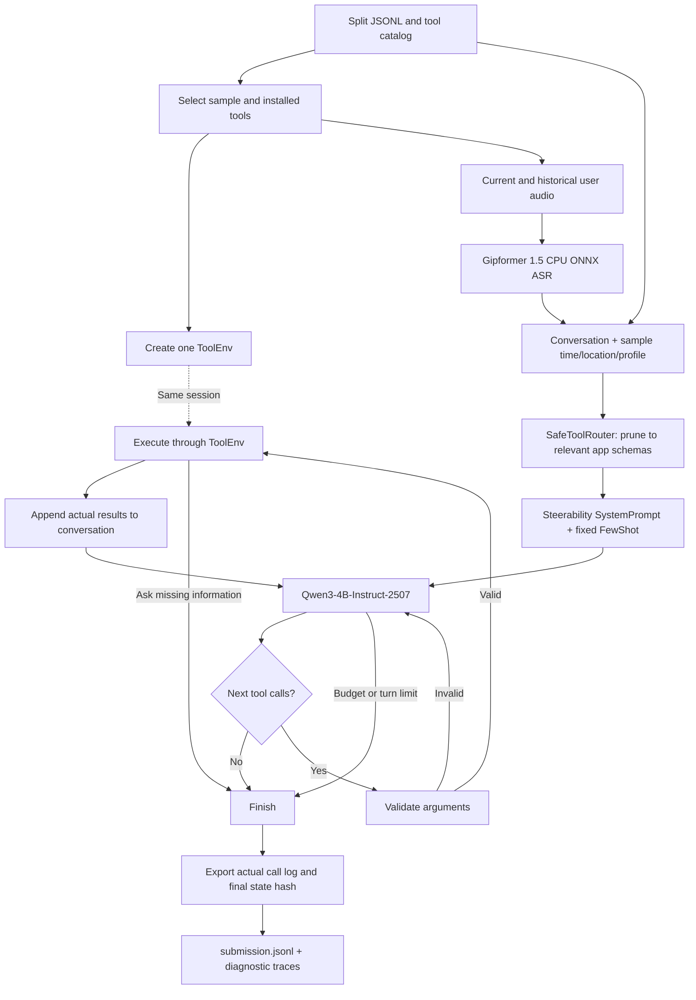

# Current LifeMate pipeline

Updated: 28 October 2026. This documents implemented behavior, not the proposed final architecture.

The pipeline has one controller: a bounded observe-act loop that may return several independent tool calls per model decision and stops on an empty decision, a clarification, the turn limit, or the deadline.

## 1. Assets loaded once per inference process

| Component | Current model | Parameters |
| --- | --- | ---: |
| Vietnamese speech recognition | `g-group-ai-lab/gipformer1.5-68M-rnnt` | 68,625,511 (publisher configuration) |
| Tool-calling language model | `Qwen/Qwen3-4B-Instruct-2507` | 4,022,468,096 |
| Combined | One ASR + one LLM | 4,091,093,607 (using reported ASR count) |

Both models use local assets. Gipformer uses sherpa-onnx 2.0.1 CPU INT8 with four threads and explicit greedy search; Qwen uses FP16 on GPU 0. Model revisions are pinned in `configs/baseline.json`. The LLM parameter count is measured from loaded parameters; the ASR count is read from its pinned publisher configuration and still needs an independent final audit. Development notebooks download assets before inference starts; a network-disabled final container is still to be tested.

There is one LLM model and no separate planner, critic, embedding, or retrieval model. No fine-tuning has been applied.

## 2. Inputs and app access

The input adapter reads the split JSONL, tool catalog, and permitted audio files. It exposes the tools installed for the sample plus `sys.ask_missing_info`. It excludes train labels and reference transcripts from normal audio inference.

One ToolEnv is constructed for each sample in an inference attempt. Only the organisers' runtime loads app data. The solution does not read environment files or inspect hidden session state. Historical tool actions have already happened and are never replayed by the agent.

## 3. Speech and conversation reconstruction

Each earlier user turn and the current request are transcribed sequentially with a reused Gipformer recognizer and a fresh stream per recording. Audio is converted to mono/16 kHz when necessary. Exact digital silence produces an empty transcript; no learned VAD is deployed. The ASR module uses only provided local graph/token paths and performs no automatic download.

The conversation combines:

- ASR transcripts of user turns.
- Existing assistant text, historical calls, and historical results.
- The sample's current time, timezone, location, and user profile.
- The allowed tools' descriptions and parameter schemas.

The text-only experiment bypasses ASR using train reference transcripts. It is an ablation for development, not the final submission path, and rejects non-train splits.

## 3b. Tool routing (SafeToolRouter)

After ASR, all transcribed user turns are concatenated into a query string. `SafeToolRouter` matches this against a hand-authored Vietnamese keyword map (27 app domains) to select the relevant installed apps. It automatically expands dependencies: selecting `sms` or `chat_ott` also pulls in `contacts`; detecting weather words adds `weather`. When the query matches nothing or fewer than four apps are installed, it falls back to the full installed set. `sys.ask_missing_info` is always retained.

Token savings: average 50-tool prompt (~7,000 characters) reduces to the tools of ~3 matched apps (~1,200 characters). Set `LIFEMATE_TOOL_PRUNING=0` to disable. The `context.installed_apps` field in the system message is also simplified to a list of app names, removing the nested tool-name arrays that duplicate the schema block.

## 4. LLM and execution loop

After conversation normalization, the real Steerability SystemPrompt control prepends the fixed instruction, preserving the existing sample context. FewShot appends at most two authored synthetic positive examples whose required tool names are available in that sample. Example order is fixed across decisions and no example selection model is loaded. The input adapters operate at message level; the existing native Qwen tool template and all allowed schemas remain intact. There is no tool retrieval or context summarizer. Prompt tokens plus generation are capped at 16,384; oversized prompts are rejected rather than silently truncated.

The system prompt explicitly instructs the model to **batch independent tool calls in one response** — for example, two reads whose results do not depend on each other. Analysis of gold trajectories shows 74.1 % of samples with both reads and writes have all reads before any write; batching those reduces the expected LLM decision count from 2.29 to 1.79 (~10 s saved). When the model returns only reads and then finishes without issuing the required write, the controller appends one short reminder and allows one more decision (`LIFEMATE_CONTINUE_AFTER_READ`).

Each decision generates at most 384 new tokens. Prompt prefill runs in 256-token query chunks to bound deterministic-attention memory on T4. The backend now reuses the exact matching token prefix between decisions within one sample. Generated tokens are removed before retaining the cache because controller/template serialization can change them. Diverging prefixes are cropped to their shared tokens or recomputed; at least the last prompt token is processed to obtain fresh logits. The runner resets the cache before and after every sample, including failed samples. Set `LIFEMATE_PROMPT_CACHE=0` for a comparison without reuse. `llm.cache` events report reused and fresh tokens; `llm.output` reports prefill and generation wall times. Initial prompt processing remains necessary, and GPU speed gains have not yet been measured.

Proposed calls are parsed and checked with `env.validate()`. Invalid calls are returned to the model without execution. Valid calls execute sequentially with `env.call()`, and their actual results enter the next model turn. Clarification stops the remaining batch immediately. Unbalanced/truncated tool-call tags raise an error rather than silently dropping an unfinished call. Execution preserves dependencies between reads and writes.

The loop ends on a no-call response, a clarification call, the sample deadline, an error, or six model decisions. Each decision may contain several independent calls; newly observed IDs are only usable in the next decision.

## 5. Budgets

- Default inference budget: 27 seconds per sample, leaving margin below the competition's 30-second limit.
- Current controlled T4 rerun: **60 seconds**, explicitly passed with `--budget-seconds 60`.
- The 60-second setting is for measuring quality on development hardware. It is not an approved competition deadline or a proven A30-equivalent budget.
- The budget starts before environment creation and includes current/history ASR, prompt processing, and model decisions. Recorded elapsed time includes export. Model loading happens before sample timing.
- Deadlines are cooperative checks. A generation stop can occur slightly after the target; there is no external process kill per sample yet. The native CPU ASR decode is blocking and checks for overruns after it returns.

## 6. Outputs and evaluation

Each sample exports its ID, `env.get_tool_calls()`, and `env.get_state_hash()`. Every executed call is included, even if rejected by the runtime. Diagnostic traces are separate from the submission.

Train evaluation happens in a separate process. It compares calls against labels and can replay gold calls in separate reference sessions to derive final-state hashes. Gold labels/results are not fed to live prediction inference.

Current experiments use the same 12 inspected train development samples. Public test has not been scored or used for tuning. The remaining 240 validation samples are reserved for a later fixed configuration.

## Source map

| Responsibility | File |
| --- | --- |
| Input/catalog/runtime adapter | `src/lifemate/input_adapter.py` |
| App-level tool router | `src/lifemate/routing.py` |
| ASR and language-model backend | `src/lifemate/backend.py` |
| Local Gipformer runtime | `src/lifemate/asr.py` |
| Message-level prompt controls | `src/lifemate/prompts.py` |
| Unmodified vendored toolkit snapshot | `vendor/steerability/` (prepared by `scripts/prepare_steerability.py`) |
| Tool loop | `src/lifemate/agent.py` |
| Inference and export | `scripts/infer.py` |
| Diagnostic metrics | `src/lifemate/evaluation.py`, `scripts/evaluate.py` |
| Dataset-backed Kaggle experiment | `scripts/build_live_evaluation.py` |
| Result aggregation | `scripts/summarize_live.py` |

Historical baseline reports remain in the original development workspace. Gipformer, prompt controls, within-sample cross-decision cache reuse, and the bounded observe-act controller are implemented. The user's 300-sample ASR comparison motivated the ASR selection; it has not been reproduced by this implementation pass. Local smoke tests establish runtime wiring, not a new task accuracy score. Full semantic verification, lossy context compaction, prompt optimization/GEPA, and fine-tuning remain unimplemented.
