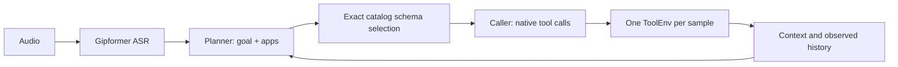

# LifeMate — App Planner / Caller

The main pipeline uses one shared `beyoru/Qwen3-4B-I-1209` model for two roles.
Planner receives catalog app descriptions, the original request, context and observed
history. It chooses the next goal and app namespaces. Python loads every permitted
function schema in those apps; Caller chooses functions and fills arguments.
The organiser ToolEnv executes calls, and actual observations drive the next plan.



Invalid plans fall back to original-query BM25 (top 8 plus catalog dependencies).
Valid app selections are not pruned by BM25. `sys.ask_missing_info` remains visible
when permitted. Plans are unverified guidance, never evidence of IDs or completion.
Both roles share one loaded model; there is no second 4B checkpoint at inference.

## Run on Kaggle

- [Train development](notebooks/kaggle_pipeline.ipynb): 3 train samples by default,
  reference transcripts, 90 seconds/sample, 8 rounds, Caller ceiling 384 tokens.
  Set TRAIN_TRANSCRIPTS=False to include real Gipformer audio. Live printing is off.
- [Public inference](notebooks/kaggle_public_test.ipynb): real audio, all public
  samples, 27-second internal budget and complete submission-format validation.
- [Frozen Caller SFT](notebooks/kaggle_caller_sft.ipynb): historical Qwen3.5 training,
  pinned to its original revision. It is not Planner training, and its adapter is
  incompatible with the beyoru inference backbone. No Planner distillation has run.

The inference notebooks pin the app Planner/Caller source commit and record
the actual checkout. Update REVISION deliberately for repeatable comparisons. Attach private `amnpham/zalochallenge`.
Downloads/installations occur during setup; inference must use local assets only.

## Local inference

```sh
python -m pip install -r requirements.txt
python scripts/download_models.py
# Set LIFEMATE_LLM_PATH=models/beyoru-qwen3-4b and LIFEMATE_ASR_PATH=models/asr.
# Set HF_HUB_OFFLINE=1, TRANSFORMERS_OFFLINE=1, PYTHONHASHSEED=42.
python scripts/infer.py --split-dir /data --backend lifemate.backend:create_backend --output result/submission.jsonl
python -m unittest discover -s tests -q
```

The default runner budget is 27 seconds. `--budget-seconds 90` is development-only.
`--step-log result/steps.jsonl` saves optional private input/output traces;
`--verbose-steps` explicitly enables live printing. The normal trace includes plans,
routing, rejected decisions and termination. Output files are never overwritten.

## Source layout

- `src/lifemate/planner_caller.py`: next-step planning, app routing, fallback and Caller guidance.
- `src/lifemate/agent.py`: the single tool execution loop and native output parsing.
- `backend.py`, `asr.py`: local model loading and deterministic generation/transcription.
- `catalog.py`, `context.py`, `retrieval.py`: catalog metadata and BM25 fallback.
- `grounding.py`, `validation.py`, `execution.py`: evidence checks and execution records.
- `scripts/infer.py`: ASR, one per-sample controller/environment and submission export.
- `scripts/evaluate*.py`, `validate_submission.py`: diagnostic scoring and format checks.
- `training.py`, `checkpointing.py`, `scripts/prepare_sft.py`, `train_adapter.py`: retained SFT support.
- `experiments/`: historical comparison runners; not imported by main inference.
- `docs/`: architecture, training notes and historical measured reports.

## Measured limits

On ten familiar train samples with reference transcripts and one T4, app routing
reached diagnostic Macro F1 0.4819, mean 22.25 seconds, and one sample at or above
30 seconds. Planner+BM25 reached 0.3361 and 32.47 seconds in the paired run.
These are pilot results, not official score, held-out accuracy or A30 compliance.
`finished` does not establish task success; conditional branches and entity choice
still fail. Three app-plan errors used BM25 fallback in that run.

The loaded LLM must remain below 5B parameters, total models below 6B, and each
prompt plus generation within 16,384 tokens. No code reads/copies/parses environment
files: application data is accessed only through organiser tools. Every actual
ToolEnv call, including failures, is exported with the real final state hash.
Public/private test labels must never be used for training or tuning.

Planner kind is read/write/mixed/meta for calls, none for done (apps=[]). It is
passed to Caller as unverified guidance and does not filter schemas or authorize
writes. Planner generation ceiling is 384 tokens, configurable via
LIFEMATE_PLANNER_MAX_NEW_TOKENS (notebooks: PLANNER_MAX_NEW_TOKENS). The existing
20-second per-plan and overall sample deadlines still apply.
