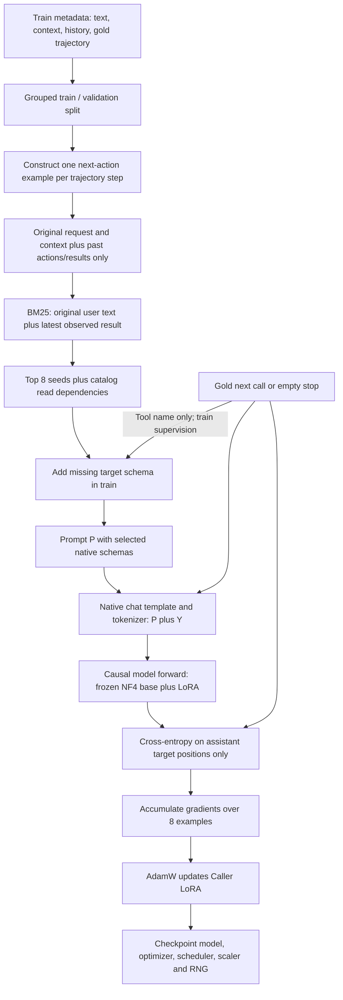

# Caller SFT input, target and loss

Current run: Qwen3.5-4B, Caller only, top-8 retrieval seeds, 4,096-token cap, one epoch on 3,938 retained next-action/stop examples. The user selected excluding and reporting 266 overlength train targets. Validation remains separate. Planner, ASR and RL are not trained in this run.



## Input

The model receives the fixed system policy, sample context (time/timezone/profile/app descriptions), original user request and history, and only previous gold actions/observations. Schemas are retrieved, not all supplied. Final schema count can exceed 8 because lookup dependencies and train-only target-schema repair are included. Current or future target arguments/results are not inserted into the prompt.

Only train receives missing target schemas from labels. This is an oracle-assisted training choice, not a property available at inference. At inference, missing tools remain a real failure risk.

Example (illustrative values, not a training row):

```text
User: Nhắn mẹ rằng con về muộn.
Past tool call: contacts.search(query="Mẹ")
Past observation: {"ok":true,"contacts":[{"id":"c_demo","name":"Mẹ"}]}
Visible schemas: selected tools including sms.send
```

## Output target

The next gold action is rendered by the official Qwen3.5 chat template:

```xml
<tool_call>
<function=sms.send>
<parameter=contact_id>c_demo</parameter>
<parameter=content>Con về muộn</parameter>
</function>
</tool_call>
```

The target is `[]` when the trajectory should stop. Targets do not contain a generated plan or a long reasoning transcript. Each supervised action target currently contains one call; inference parsing still supports multiple calls. Tool results are taken from the provided train trajectory, not executed live against apps during the SFT loss computation.

## Loss and causal masking

Let `P` be the prompt tokens and `Y=(y1,...,yM)` the templated assistant completion, including framing/end tokens. Encoding produces:

```text
input_ids: [ P1 P2 ... PN | y1 y2 ... yM ]
labels:    [ -100 ... -100 | y1 y2 ... yM ]
                           ^ supervised completion
```

Teacher forcing supplies gold preceding target tokens. The decoder's causal attention/recurrent structure prevents a prediction from seeing its current/future gold token. Logits at position p predict label p+1. The implementation selects positions whose shifted labels are not -100 and computes mean cross-entropy:

`L_example = -(1/M) * sum_j log P(y_j | P, y_<j)`

System instructions, user text, schema and past observations are conditioning context and receive no direct target loss. They still require model computation and can contribute through attention to gradients of trainable adapters. Masking is not equivalent to removing prompt computation.

Vocabulary logits are materialized only at supervised positions to save memory; the prefix is still processed. With batch size 1 and accumulation 8, a typical optimizer update averages gradients from eight per-example mean losses. The last incomplete group contains the remaining examples. Only text attention LoRA parameters are optimized: q_proj/k_proj/v_proj/o_proj, rank 16, alpha 32, dropout 0, 32 projection modules, 3,145,728 trainable parameters.

## Validation and progress

The raw split has 1,332 train requests and 213 validation requests. Of 4,204 train targets, 3,938 remain after length filtering. Of 664 original validation targets, 107 have missing target schemas and are excluded from loss; 17 of the remaining 557 exceed the length cap, leaving 540 teacher-forced loss examples. No gold schema repair is applied to validation. Validation loss is therefore conditional and cannot substitute for task accuracy on all 213 requests with genuine retrieval.

The full epoch targets 493 optimizer steps, batch 1, accumulation 8, learning rate 5e-5 with a 5% warmup, checkpoint interval 10, validation-loss interval 100. Session boundaries save state for resume; they do not restart the LR schedule or the epoch. A partial checkpoint must not be described as a finished epoch. F1 and final app-state success are separate later evaluations, not the training loss or an RL reward.
